  

  
  &nbsp;
  

## 🌼 Dashboard

  <picture>
    <source media="(prefers-color-scheme: dark)" srcset="assets/dashboard-dark.svg">
    <source media="(prefers-color-scheme: light)" srcset="assets/dashboard-light.svg">
    
  </picture>

Rebuilt every day by a GitHub Action from my public activity — see <a href="scripts/dashboard.py">scripts/dashboard.py</a>.

## 🛠️ Featured projects

| Project | What it does | Stack |
|---|---|---|
| 🌉 [**zen-debug-bridge**](https://github.com/WoodyWizard/zen-debug-bridge) | Local-first observability and control bridge for Zen Browser |  |
| 🖥️ [**gnome-desktop-bridge**](https://github.com/WoodyWizard/gnome-desktop-bridge) | Consent-gated debugging and automation bridge for GNOME on Wayland |  |
| ⭐ [**ZenExtensionShortcuts**](https://github.com/WoodyWizard/ZenExtensionShortcuts) | Favorites panel under Zen Browser's floating new-tab URL bar |  |
| 🧩 [**zen-ext**](https://github.com/WoodyWizard/zen-ext) | Install any extension into Zen Browser without publishing to AMO |  |
| 🔐 [**SecretStream**](https://github.com/WoodyWizard/SecretStream) | Encrypt your livestream; viewers decrypt it with a browser extension and a key |  |
| 💬 [**just_chat_rust_twitch**](https://github.com/WoodyWizard/just_chat_rust_twitch) | Minimal Twitch chat client |  |

Also contributing to [**rwmt/Multiplayer**](https://github.com/rwmt/Multiplayer) (RimWorld co-op) and hacking on the [GLVMEngine](https://github.com/WoodyWizard/GLVMEngine_neurohruchevo_edition) Vulkan/OpenGL engine.

## 🧰 Toolbox

  

Daily driver: Fedora · GNOME on Wayland · Zen Browser · Neovim · Ghostty

## 🐍 Contribution snake

  <picture>
    <source media="(prefers-color-scheme: dark)" srcset="https://raw.githubusercontent.com/WoodyWizard/WoodyWizard/output/snake-dark.svg">
    <source media="(prefers-color-scheme: light)" srcset="https://raw.githubusercontent.com/WoodyWizard/WoodyWizard/output/snake-light.svg">
    
  </picture>

---

  If something here saved you time — a coffee keeps the chamomile woods growing 🌼  
  

